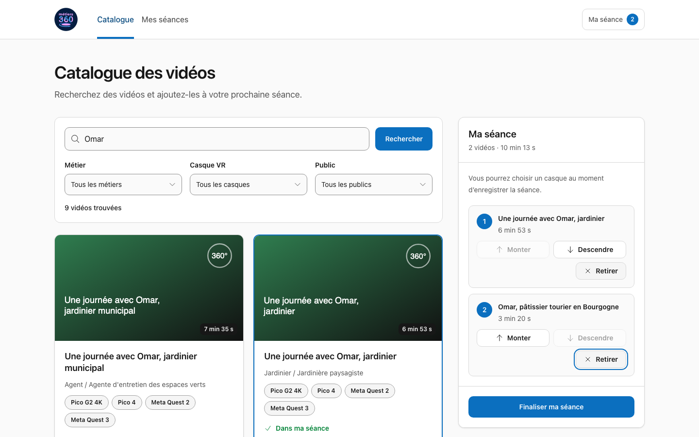
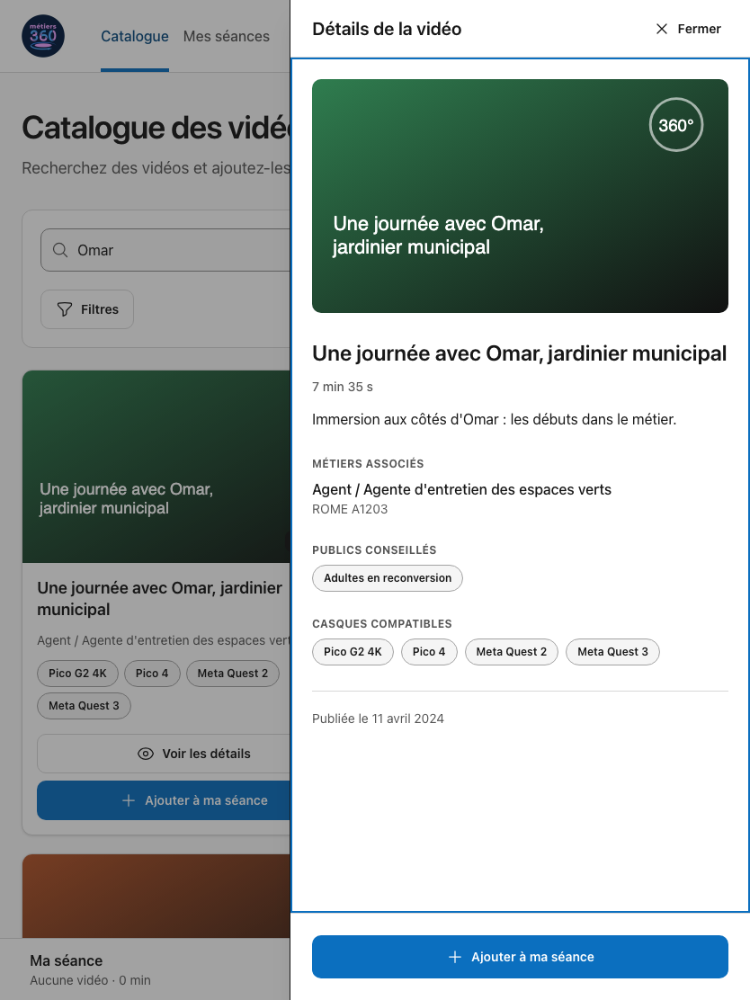
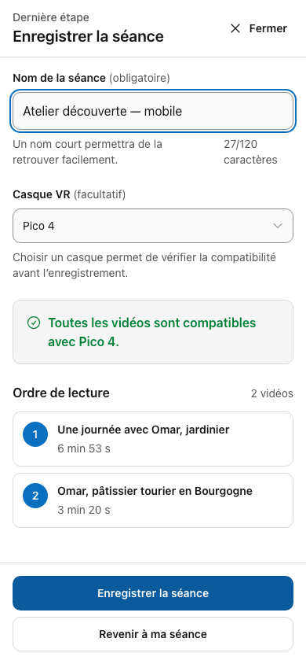

# Métiers360 : préparer une séance de découverte

Une application pour les conseillers, enseignants et éducateurs qui préparent une sélection de vidéos métiers à faire découvrir à un groupe, souvent sur tablette et avec peu de temps de préparation.

**[Ouvrir la démonstration en ligne](https://web-production-2e0a66.up.railway.app)** — les séances enregistrées sont partagées entre les visiteurs de cette démonstration et disparaissent au redémarrage de l’API. Le [guide de déploiement](docs/deployment.md) décrit les deux services et la procédure de publication.

## Lancer le projet

Node.js **22.23.4 minimum** et npm. Vérification réalisée avec Node 24.14.1 et npm 11.17.0.

```bash
npm ci
npm --prefix server ci
npm run dev
```

Application : [localhost:4321](http://localhost:4321). API simulée : [localhost:4000](http://localhost:4000). Aucun fichier d’environnement n’est nécessaire. Pour une autre adresse d’API, définir la variable serveur `CATALOG_API_URL`.

Pour le serveur de production, démarrer l’API dans un terminal :

```bash
npm run start:api
```

Puis l’application dans un autre :

```bash
npm run build
npm start
```

## Utiliser l’application

1. Rechercher une vidéo **par titre**, puis filtrer par métier, casque ou public.
2. Consulter ses détails et l’ajouter à **Ma séance**. Sans filtre casque, la carte présente toutes ses compatibilités ; avec un filtre, elle affiche le casque choisi.
3. Utiliser **Monter**, **Descendre** et **Retirer** pour préparer l’ordre de lecture. Le brouillon est conservé dans ce navigateur lors d’un rechargement ou d’un changement de page.
4. Choisir **Finaliser ma séance**, saisir un nom et, éventuellement, un casque. Consulter les avertissements de compatibilité avant d’enregistrer.
5. Retrouver la confirmation, la liste et le programme enregistré dans **Mes séances**.


*Le catalogue et la séance restent consultables ensemble sur ordinateur.*

<details>
<summary>Voir les vues tablette et mobile</summary>


*Les détails s’ouvrent sans quitter le catalogue.*


*La dernière étape regroupe les informations utiles à l’enregistrement.*

</details>

## Trois hypothèses structurantes

1. **Un seul brouillon local suffit.** La préparation en cours appartient au navigateur utilisé ; aucun compte ou partage entre appareils n’a été ajouté.
2. **Reconsulter les séances enregistrées est utile.** L’API expose une collection : une liste et un programme en lecture seule prolongent donc le parcours après l’enregistrement.
3. **L’utilisateur garde la décision sur le casque.** Le choix reste facultatif comme dans l’API ; une incompatibilité est signalée explicitement, sans supprimer automatiquement des vidéos de la sélection. Je ne sais pas si, dans la réalité, cette hypothèse « tient la route ».

## Trois choix pour l’interface utilisateur

- **Deux destinations, un brouillon transversal.** `Catalogue` et `Mes séances` structurent la navigation. Le panneau sur ordinateur et la feuille sur tablette/mobile gardent la préparation à portée de main. Concernant ce point, j’ai en fait choisi un type de navigation et d’interactions assez proche de ce que l’on pourrait avoir sur une plateforme d’e-commerce, où le « shopping cart » est ici remplacé par un « video cart » (Ma séance). Je me suis dit qu’une telle expérience était familière pour un grand nombre de personnes et que cette familiarité aiderait les utilisateurs à prendre l’application en main plus facilement.
- **Des actions explicites.** Les commandes d’ordre fonctionnent au clavier et au toucher. Après un retrait, le focus reste dans la séance, y compris lorsqu’elle devient vide.
- **Des erreurs récupérables.** Chargement, absence de résultats, données indisponibles et échec d’enregistrement sont distingués. Un échec conserve le brouillon ; les requêtes d’écriture ne sont pas rejouées automatiquement.

## Stack technique et organisation

**Astro avec son outillage Vite**, React 18 et TypeScript strict : Astro prend en charge les pages et les routes serveur ; React porte les interactions. Une fine couche BFF (Backend For Frontend) relaie les appels du navigateur vers l’API fournie et garde son adresse côté serveur.

Zod valide les données externes et persistées. TanStack Query gère les données distantes ; Nano Stores partage le brouillon entre les îlots React. Tailwind, des primitives locales issues de shadcn/Base UI et Heroicons forment la couche d’interface. Les filtres et la pagination restent dans l’URL.

Voir [l’architecture](docs/architecture.md) et [le contrat de l’API](API.md).

## Vérifier

```bash
npm run verify
npx playwright install chromium
npm run test:browser
```

`verify` regroupe formatage, ESLint, vérification Astro/TypeScript stricte, **95 tests unitaires/composants** et build serveur. La suite navigateur démarre ses propres services sur les ports **4100 et 4323**, couvre ordinateur, tablette et mobile, et conserve les traces en cas d’échec. Le [protocole de vérification](docs/delivery-verification.md) décrit les parcours, les résultats et leurs limites.

L’accessibilité a fait l’objet de vérifications axe et manuelles : clavier, focus, libellés, contraste, réduction des mouvements et débordements. Les contrôles compacts de séance mesurent 36px de haut et satisfont le minimum AA de 24px. Ces vérifications **ne constituent pas une déclaration de conformité WCAG/RGAA** ; aucun audit exhaustif avec lecteur d’écran n’est revendiqué. Voir [le détail des audits](docs/accessibility-audit.md).

## Limites et suite

Les séances enregistrées sont **en mémoire dans l’API** et disparaissent à son redémarrage. Le brouillon local n’est pas une sauvegarde partagée. La recherche suit le contrat fourni : sous-chaîne du titre, sans recherche sémantique.

Pas d’édition/suppression des séances enregistrées, d’authentification, de diffusion réelle vers les casques ou de glisser-déposer : ces capacités dépassent l’API ou ne sont pas nécessaires au parcours démontré. La démo déployée sur Railway reste un environnement d’exercice.

Avec une journée de plus : idéalement, tester le parcours avec un professionnel de l’accompagnement. J’aurais alors retravaillé les points soulevés lors des tests avec l’accompagnateur et, si le temps le permettait encore, j’aurais certainement mené une session dédiée avec lecteur d’écran (VoiceOver par exemple) et approfondi les cas de focus/zoom, peut-être implémenté une page d’accueil distincte du catalogue et un mécanisme permettant de vider/remettre à zéro une séance en cours de construction sans avoir à retirer chaque vidéo une à une et, enfin, sans doute retravaillé encore certains détails visuels.

## IA, travail personnel et attention

J’ai utilisé l’IA pour explorer des idées concernant l’expérience utilisateur (utilisateurs pressés pas toujours complètement à l’aise avec les outils digitaux), réaliser des maquettes au format texte pour étudier l’architecture de l’information et servir de point de départ pour la réalisation de l’interface. Je m’en suis également servi pour échanger sur des sujets tels que l’architecture, mais également pour définir un plan d’implémentation, produire et faire évoluer les composants, écrire des tests, préparer les audits et enfin maintenir la documentation du projet. Les méthodes appliquées (consignes pour les agents IA contextualisées par type d’activité) sont recensées dans [le registre des skills](docs/skill-log.md).

J’ai choisi de ne pas laisser l’IA produire toute l’application toute seule ; en effet, j’ai préféré travailler étape par étape afin de pouvoir garder un certain contrôle, comprendre et corriger si besoin ce qui était produit et faire des arbitrages. J’ai donc relu et vérifié chaque étape dans l’IDE **WebStorm** que j’ai utilisé pour le projet, testé manuellement dans **Firefox et/ou Chrome**, et apporté des modifications de code et de CSS entre les étapes. Le dernier correctif de focus a également été retesté manuellement avant commit et push. Les commandes automatisées et les mesures consignées dans les rapports ont été exécutées par l’agent.

**Exemples de décisions prises à l’encontre de propositions de l’IA :** l’outil recommandait initialement React 18 et TypeScript seuls, jugeant Astro excessif pour cet exercice. J’ai quand même finalement retenu Astro et les îlots React pour servir le contenu initial côté serveur et limiter l’hydratation aux interactions. L’objectif était d’améliorer le chargement et le rendu initial. J’ai également demandé d’afficher tous les casques compatibles au lieu d’en masquer une partie, et de préserver les wireframes originaux plutôt que de les réécrire après l’implémentation.

**Attention estimée : environ 6 h 30, réparties sur 7 à 8 sessions.** Ce total dépasse le budget initial d’une demi-journée si l’on considère une journée de travail de 8 h ; ce temps de 6 h 30 exclut l’exécution autonome de l’agent et inclut cadrage, lecture, revue, corrections et tests manuels.

Le [sujet original, conservé à l’identique](docs/source/exercise-brief.md), reste la source des exigences. Les [wireframes initiaux](docs/wireframes) sont conservés comme exploration préalable, pas comme une spécification exhaustive de l’interface livrée.
